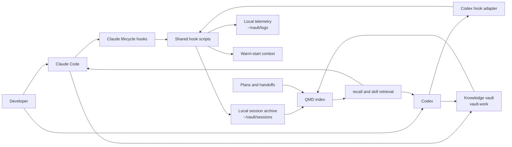

# claude-harness

A local operating system for long-running work with Claude Code and Codex.

The repository combines lifecycle hooks, reusable skills, session export, local search, and a
starter Obsidian vault. Its main job is continuity: an agent starts with the project's current
state, follows the same safety and verification rules while it works, and leaves behind useful
context for the next session.

The harness is deliberately local-first. Session archives, search indexes, knowledge notes, and
telemetry stay on the machine unless you configure an external integration yourself.

## Why this exists

AI coding sessions are useful, but they are oddly forgetful. A new session can lose the reason behind an architectural choice, repeat an investigation that already happened, or declare a task finished without the check that mattered. Good working habits often end up trapped in one long chat or in one developer's machine setup.

This harness began as a way to make those habits durable. It turns decisions, handoffs, safety rules, and verification steps into local files and repeatable lifecycle hooks instead of relying on the model to remember them. The goal is not to add ceremony to every edit. It is to let a developer leave a project, come back later (or switch between Claude Code and Codex), and resume with the important context intact.

It also makes the setup portable. A fresh machine should be able to inherit the same guardrails and continuity system without inheriting somebody else's private notes or credentials.

## What it provides

- A shared development workflow for planning, worktree isolation, debugging, review, and
  evidence-based completion.
- Claude Code hooks for warm starts, file and command guards, post-edit checks, pre-compaction
  capture, session export, and local telemetry.
- A Codex adapter for the same lifecycle events, plus native Codex session catalog, export, and
  pre-compaction state snapshots.
- Seventeen global Claude skills, including `workflow-engine`, `recall`, `vault-push`,
  `review-merge`, `infra-health`, `drawio`, and `humanizer`.
- A ready-to-seed knowledge vault with project logs, ADRs, handoffs, daily notes, templates,
  capture skills, and an Obsidian configuration.
- QMD-backed hybrid retrieval over session transcripts, plans, daily notes, and project knowledge.
- Import tools for local Claude Code sessions, Codex sessions, and Claude account exports.

## How it fits together



There are two separate vaults:

| Location | Purpose | Lifecycle |
|---|---|---|
| `~/vault/` | Machine-local runtime data: exported sessions, hook scripts, logs, and generated notes | Created and wired by the installer |
| `~/Documents/vault-work/` by default | Curated, git-friendly knowledge: projects, decisions, dailies, people, and handoffs | Seeded once from `vault-template/`, then owned by you |

## Repository layout

| Path | Role |
|---|---|
| `claude/` | Claude Code settings, warm-start entry point, and global skills |
| `codex/` | Codex hook manifest, adapter, exporters, doctor, and configuration example |
| `vault-scripts/` | Shared safety, continuity, retrieval, telemetry, and verification hooks |
| `vault-template/` | Empty knowledge-vault scaffold, capture skills, commands, templates, and setup scripts |
| `install.sh` | Installs Claude/shared assets and seeds a new knowledge vault |
| `install-codex.sh` | Adds Codex scripts and hooks without changing Claude settings |
| `update.sh` | Pulls and reconciles an existing Claude/shared installation |
| `verify-setup.sh` | Read-only health report for links, dependencies, QMD, Codex, and vault state |
| `catalog-*.sh`, `read-*.sh` | Inspect prior Claude Code, Claude chat-export, and Codex history |
| `tests/` | Clean-room installer and hook safety smoke tests |

## Requirements

The core scripts expect Bash, Git, `python3`, `jq`, and `rsync`. The setup is primarily designed
for macOS, while the clean-room and hook suites also run on Ubuntu in CI.

QMD is optional for installation but required for semantic recall and task-start skill retrieval.
It needs Node.js 22+ or Bun; macOS also needs SQLite:

```bash
brew install sqlite
npm install -g @tobilu/qmd
```

The first embedding run downloads local models and can use roughly 2 GB of cache space. GitHub CLI
is optional and used by GitHub-oriented workflows. Audio capture and transcription have additional
macOS dependencies documented in `vault-template/System/docs/WORK_MACHINE_SETUP.md`.

## Install for Claude Code

```bash
git clone https://github.com/tarangdeep-goel-by/claude-harness.git
cd claude-harness

# Inspect missing dependencies without installing anything.
./bootstrap.sh --check

# Install the shared engine and seed the default knowledge vault if it is empty.
./install.sh

# Report remaining setup gaps.
./verify-setup.sh
```

To seed a different knowledge-vault location:

```bash
./install.sh --vault "$HOME/Documents/my-vault"
./verify-setup.sh --vault "$HOME/Documents/my-vault"
```

`install.sh` is idempotent, but it is not a passive copy command:

- It copies the adopter settings to `~/.claude/settings.json` when needed. If an existing settings
  file does not contain harness hooks, the installer backs it up and moves non-hook fields to
  `settings.local.json` when `jq` is available and no local override already exists.
- It replaces conflicting skill and hook-script targets with symlinks into this repository.
- It seeds `vault-template/` only when the chosen knowledge-vault directory is empty. It does not
  merge the template into an existing vault.

Keep machine-specific Claude settings in `~/.claude/settings.local.json`. Maintainers who need the
owner settings variant can use `HARNESS_OWNER=1 ./install.sh`.

For the guided path, ask Claude Code to read [`SETUP_FOR_CLAUDE.md`](SETUP_FOR_CLAUDE.md). The
machine setup script can also configure QMD, launchd jobs, and optional transcription tooling; read
the runbook before running it because it installs packages and downloads models.

## Add Codex support

Run the shared installer first, then install the Codex-specific layer:

```bash
./install.sh
./install-codex.sh
python3 ~/.codex/scripts/codex_hooks_doctor.py
```

`install-codex.sh` links runtime scripts into `~/.codex/scripts`, renders `~/.codex/hooks.json`
with absolute paths, and backs up conflicting Codex files. It intentionally does not overwrite
`~/.codex/config.toml`. Merge only the settings you want from
[`codex/config.example.toml`](codex/config.example.toml), including `features.codex_hooks = true`.

Codex and Claude keep their native histories. Both export cleaned Markdown into
`~/vault/sessions`, where QMD can search them together. Codex transcript export is enabled by the
finalization path; semantic memory updates are separate and opt-in:

```toml
[shell_environment_policy.set]
CODEX_HARNESS_MEMORY_SYNC = "1"
```

That option sends selected session content to the Gemini API and can update Codex memory and local
vault notes. Leave it unset if you want export without model-assisted memory writes. See
[`SETUP_FOR_CODEX.md`](SETUP_FOR_CODEX.md) for the full setup and verification sequence.

## Daily workflow

At session start, the harness gathers repository state, recent handoffs, and QMD context. During a
session, the operating contract routes work through task triage, worktrees, focused debugging, and
fresh verification. Pre-compaction and stop hooks preserve transcripts; `vault-push` records the
decisions and handoff material worth keeping.

Useful commands:

```bash
# Search indexed knowledge directly.
qmd query "why did we choose this architecture" -c sessions -c projects

# Inspect recent native histories before importing them.
./catalog-sessions.sh 30
./catalog-codex-sessions.sh 30
./catalog-chats.sh conversations.json 30

# Read one selected history item without tool noise.
./read-session.sh <session-id>
./read-codex-session.sh <session-id>
./read-chat.sh conversations.json <chat-id>
```

To populate a new vault, use [`ADOPT_EXISTING_DATA.md`](ADOPT_EXISTING_DATA.md) for existing files
and [`ADOPT_FROM_HISTORY.md`](ADOPT_FROM_HISTORY.md) for agent history. Both workflows are additive
and require review before importing material.

## Verification

```bash
# Read-only installation report; warnings do not make the script fail.
./verify-setup.sh
./verify-setup.sh --json

# Hook syntax, output contracts, and destructive-command guards.
bash tests/hooks-smoke.sh

# Codex manifest, installer, export, pre-compact snapshot, and adapter behavior.
bash tests/codex-smoke.sh

# Fresh-install and update behavior in a temporary HOME.
bash tests/clean-room.sh
```

The GitHub Actions workflow runs the hook and clean-room suites on macOS and Ubuntu.

## Updating and removal boundaries

```bash
# Pull with --ff-only when the checkout is clean, then reconcile links and shared vault infra.
./update.sh

# Reconcile without pulling from Git.
./update.sh --no-pull
```

`update.sh` refreshes Claude settings with a timestamped backup, relinks current skills and hook
scripts, prunes stale harness-owned symlinks, and syncs `System/scripts` and `System/templates` into
the knowledge vault. It does not overwrite notes or force-merge `daily-jobs.yaml`.

Codex assets are managed separately; rerun `./install-codex.sh` after pulling Codex-side changes.
The repository does not ship an uninstall command. Remove installed links and copied configuration
only after reviewing their targets and backups.

## Security and privacy

- File guards cover common secret files and key formats; command guards block a focused set of
  destructive shell and Git patterns. They are defense in depth, not a sandbox.
- Several hooks can change local state: post-edit checks may run tests, stop hooks may create a Git
  stash, and exporters write local archives and logs.
- `settings.json` and `hooks.json` control every session. Review them before installation and
  restart the client after changes.
- Secrets, native session caches, exported sessions, QMD models, and telemetry do not belong in
  this repository. Use [`SECRETS.example.md`](SECRETS.example.md) as a placement guide.
- No telemetry uploader is included. Optional third-party MCP servers, plugins, and semantic
  memory sync have their own network and data-access implications.

## License

MIT. See [`LICENSE`](LICENSE). The bundled `humanizer` skill includes its own MIT license.
